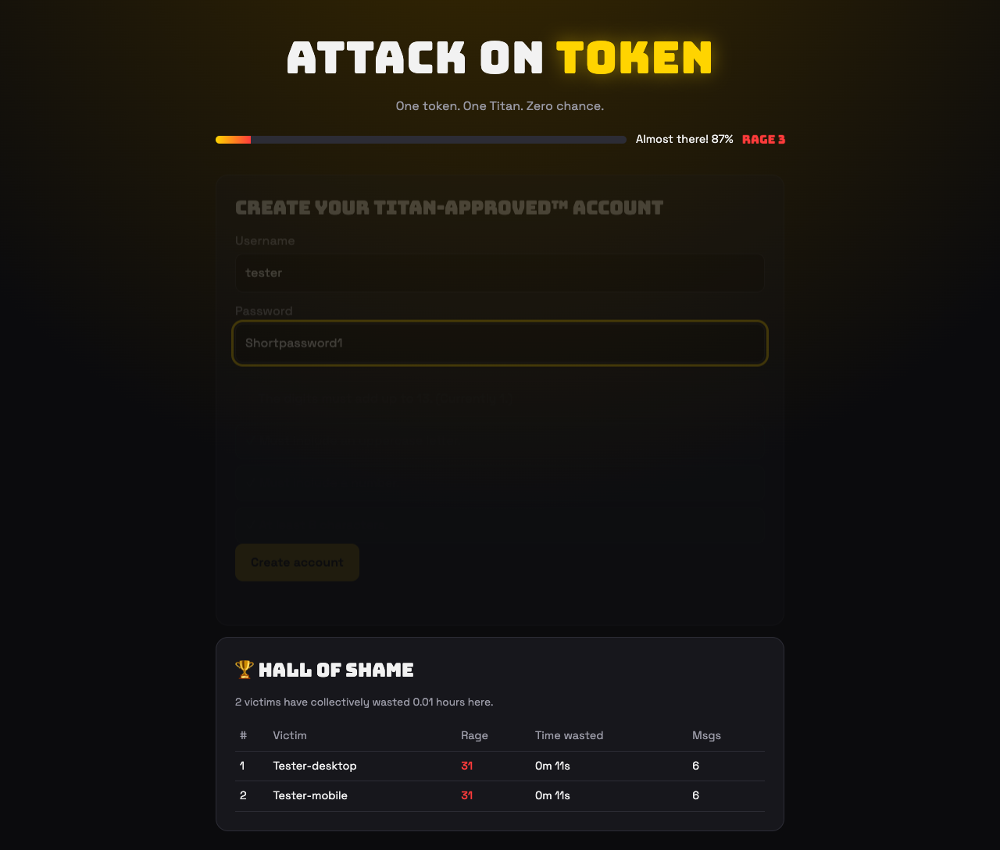
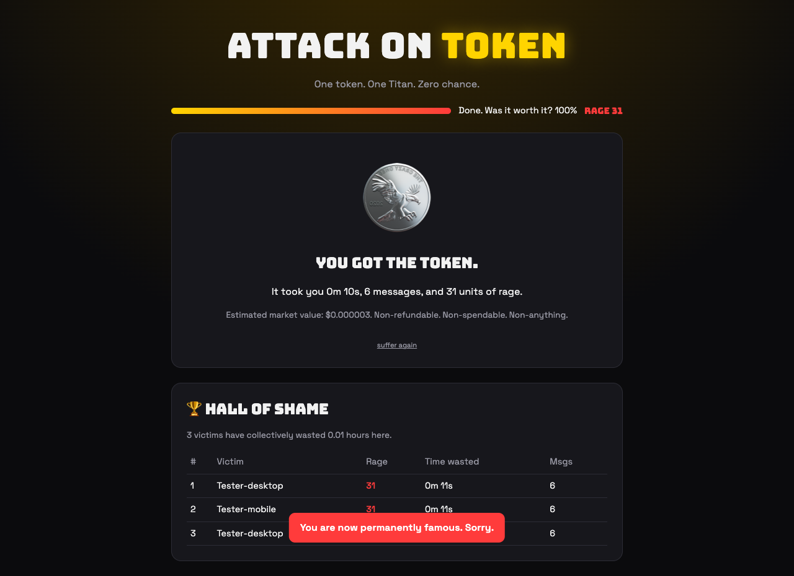

# 🪙 Attack on Token

> One token. One Titan. Zero chance.

A rage-bait website where you claw past the web's most hated dark patterns and then have to **out-argue a smug AI giant** to win a single worthless token. Your suffering is saved forever in the **Hall of Shame**.



## The gauntlet

| Stage | What makes you angry |
|---|---|
| 🍪 **Cookie wall** | The "reject" button runs away from your cursor. If you do catch it, it accepts all cookies anyway. |
| 🔐 **Sign-up** | Password rules show up one at a time: digits that add to 13, a month, "titan" backwards, an emoji, a prime length… Then your username is "already taken". By you. |
| 🤖 **CAPTCHA** | "Select all tokens." Your first try is always wrong, and the grid reshuffles after every miss. |
| 😏 **Token Titan** | An AI villain who roasts every argument you make, cites fake "Token Law", and only gives in to real wit (or persistence). |
| 🏆 **Victory** | You get one token, worth $0.000003. Put your name in the Hall of Shame. |

Running gags: a **rage meter** that goes up with every annoyance, a **progress bar that lies** (87% → 34% → 99%), a **rage-click detector**, and a Titan who types slowly on purpose.



## Run it

Needs **Node.js 24.2+**. There are **zero dependencies**: `node:http` serves the app and `node:sqlite` stores the data.

```bash
npm start            # http://localhost:3000
npm test             # unit + HTTP end-to-end tests
```

### Turn on the real AI Titan (optional)

```bash
ANTHROPIC_API_KEY=sk-ant-... npm start
```

With a key, the Titan runs on Claude (`claude-haiku-5-5` by default; override with `TITAN_MODEL`). Without one, or if the API call fails, it falls back to a scripted Titan, so the demo always works. Hint for the scripted version: manners matter, eventually.

| Env var | Default | Purpose |
|---|---|---|
| `PORT` | `3000` | HTTP port |
| `DB_PATH` | `./data.db` | SQLite file (`:memory:` for throwaway) |
| `ANTHROPIC_API_KEY` | — | Turns on the Claude-powered Titan |
| `TITAN_MODEL` | `claude-haiku-5-5` | Claude model id |

## How it works

```
public/            static frontend (vanilla HTML/CSS/JS, no build step)
  index.html       all five stages + Hall of Shame
  app.js           stage flow, rage meter, chat client
  rules.js         password rules (shared with tests)
server.js          HTTP server, SQLite persistence, Titan AI
test.js            node:test suite
```

**API**

- `POST /api/chat` `{history:[{role,content}]}` → `{reply, surrender}`. Rate-limited to 20 requests/min per IP.
- `GET /api/leaderboard` → `{top:[…], totals:{runs, seconds}}`
- `POST /api/runs` `{name, seconds, rage, messages}` → updated leaderboard

The server, not the model, decides the fairness rules. The Titan can't surrender before your 4th message, and it always gives up at your 12th, however stubborn the model is. Every input is validated by length and type, and the frontend renders all text with `textContent`, so nothing is injected as HTML.

## Known limits

- Scores are reported by the client, so a determined cheater can fake a run. It's a Hall of *Shame*; cheating there is its own punishment.
- The rate limiter lives in memory, so it resets on restart and isn't shared across instances.

## License

MIT
