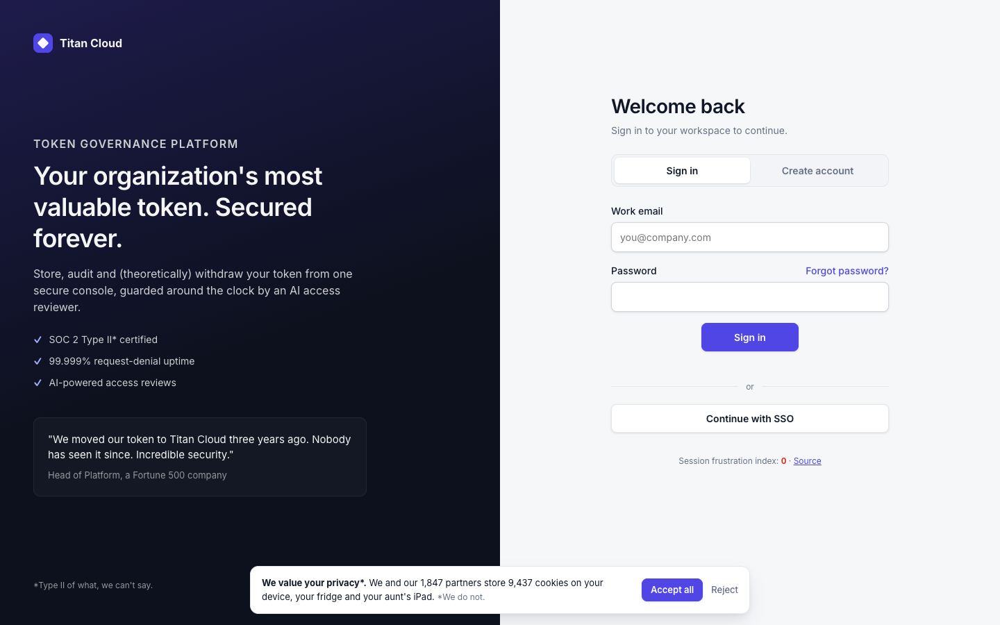
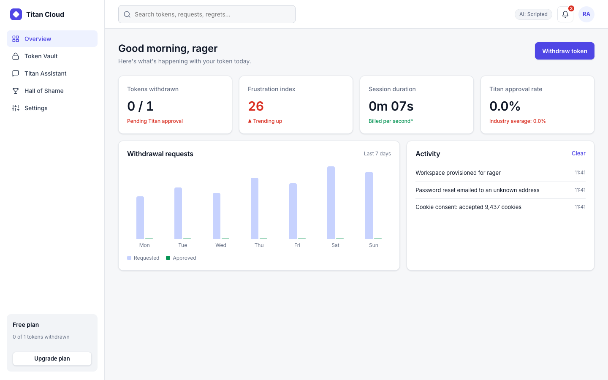

# 🪙 Attack on Token

> A polished enterprise portal that slowly, deliberately ruins your day.

**Live demo:** https://attack-on-token.onrender.com (free tier: the first visit may take about a minute to wake up)

**Titan Cloud** looks like a serious SaaS product for "token governance". Underneath, it's a rage-bait gauntlet. You fight a login portal built to fail you, then try to withdraw your organization's single token, which is guarded by **TOKEN TITAN**, a smug AI access reviewer. Every frustration is counted, and the people who make it through are honored in the **Hall of Shame**.

The joke is the contrast: the interface looks trustworthy, and every interaction betrays it.



## Two-page architecture

The whole site is **exactly two pages**. Everything else lives in tabs, modals, popovers, drawers and expandable sections on those pages.

| Route | Page | What happens there |
|---|---|---|
| `/` | **Login portal** (`public/index.html`) | Sign-in and Create-account tabs, forgot-password popover, cookie consent bar, terms panel, provisioning modal |
| `/dashboard` | **Main dashboard** (`public/dashboard.html`) | Sidebar tabs (Overview, Token Vault, Titan Assistant, Hall of Shame, Settings), CAPTCHA modal, victory modal, notifications and account popovers, search popover, mobile nav drawer |

The server's `PAGES` map is the only way to reach a page. Direct `*.html` requests and every other path return 404, and `npm test` enforces this (see below). Opening `/dashboard` without a session sends you back to `/`.

## The rage-bait mechanics

**Login portal**
- **Cookie consent:** the "Reject" link runs away from your cursor. If you catch it, it accepts every cookie anyway.
- **Dodging sign-in button:** it slides away the first four times you go for it.
- **Sign-in never works:** first "Incorrect password", then "No workspace found". You *must* create an account.
- **Forgot password:** "We emailed a reset link to an email address. Not necessarily yours."
- **SSO:** "Your administrator is the Titan. The Titan says no."
- **Escalating password rules:** they appear one at a time. Digits must add up to 13, include a month, include "titan" backwards, include an emoji, and the length must be prime.
- **Lying strength meter:** the better your password, the *weaker* it says it is.
- **Show password:** reveals it for 1.5 seconds.
- **Terms checkbox:** unchecks itself the first time and makes you review the Terms.
- **Username "already taken":** by you.
- **Provisioning progress:** 12% → 87% → 34% → 99%… → done.

**Dashboard**
- **Looks legitimate:** KPI cards, an activity feed, a withdrawal-requests chart (thousands requested, zero approved), plan usage.
- **Withdraw token → CAPTCHA modal:** "select all tokens" among look-alike coins. Your first try always fails, and the grid reshuffles after every miss.
- **Titan Assistant:** the AI roasts every argument you make. It can't give in before your 4th message and always gives in at your 12th.
- **Victory modal:** a spinning token, your stats, and a pre-filled name for the Hall of Shame.
- **Hall of Shame:** a leaderboard stored in SQLite, ranked by rage.
- **Small cruelties:** notifications come back 5 s after "Mark all read". Settings toggles switch themselves back off ("The Titan prefers zero-factor authentication"). "Upgrade plan" costs one token. Search results are "a premium feature". "Clear" on the activity log adds an entry that can't be cleared.
- **On both pages:** a **frustration index** (rage meter) and a **rage-click detector** (3 clicks within 700 ms). Session state carries from the login page to the dashboard through `sessionStorage`.



## Rage pack (v1.1)

- **Popup notifications** every 18 s (dismissing three spawns a notification about dismissing notifications). On phones, one popup at a time.
- **Blocking alerts:** a session-expiry countdown, an unsaved-changes warning on every 4th sidebar click, and a newsletter nag with confirmshaming decline buttons.
- **Roach-motel sign-out:** a double-negative confirm, a mandatory survey, then a "$0 → $0" offer. **Reset session** in Settings is the direct way out.
- **Fake urgency banner** that resets itself and comes back after you dismiss it.
- **Bad controls:** a slider phone-number input, a random-value volume control, and a "Leave site?" prompt.
- **Shaking buttons:** random primary buttons jitter; Verify, Send and Create account tremble on hover.
- **Tia, the help bubble** on the login page, who keeps coming back.

See [SUBMISSION.md](SUBMISSION.md) for the hackathon write-up and the demo video script.

## Roll back

`v1.0-two-page` is a git tag marking the version before the rage pack. To restore it without rewriting history:

```bash
git revert --no-edit v1.0-two-page..HEAD && git push   # Render redeploys the old version
```

To undo the rollback later, revert the revert commits (`git log` shows them).

## Run it

Requires **Node.js 24.2+**. There are **no dependencies to install**: `node:http` serves the app and `node:sqlite` stores the data.

```bash
npm start     # http://localhost:3000
npm test      # unit, API, and two-page-constraint tests
```

### AI: live Claude or scripted fallback

```bash
ANTHROPIC_API_KEY=sk-ant-... npm start
```

- **With a key**, the Titan is a live Claude model (`claude-haiku-5-5` by default; override with `TITAN_MODEL`). The top bar shows **AI: Live**.
- **Without a key**, the Titan uses a clearly labeled **scripted fallback**. The top bar shows **AI: Scripted** and the chat header says "Scripted fallback · no live AI response". Hint: manners eventually work.
- **Every chat reply includes `source: "claude" | "scripted"`**, and the UI updates per reply. If a live API call fails mid-conversation, the reply is labeled scripted. The app never presents a scripted reply as AI.

| Env var | Default | Purpose |
|---|---|---|
| `PORT` | `3000` | HTTP port |
| `DB_PATH` | `./data.db` | SQLite file (`:memory:` for throwaway) |
| `ANTHROPIC_API_KEY` | — | Turns on the live Claude Titan |
| `TITAN_MODEL` | `claude-haiku-5-5` | Claude model id |

## Deploy (Render)

`render.yaml` is a Render Blueprint for one web service on Render's **free** plan.

> **Free-plan caveat:** free instances have no persistent disk. The SQLite Hall of Shame resets whenever the service sleeps (after about 15 min idle) or redeploys, and the first visit after a sleep takes about a minute to wake it. For permanent scores, switch to `plan: starter` and add a `disk` mounted at `/var/data` with `DB_PATH=/var/data/data.db` (about $7/mo).

1. Open https://dashboard.render.com/blueprint/new?repo=https://github.com/Sree24-ui/attack-on-token
2. Leave `ANTHROPIC_API_KEY` blank for the scripted Titan, or paste a key for the live one.
3. Click **Apply**. Every push to `main` redeploys automatically.

## Project layout

```
render.yaml          Render Blueprint (free web service)
server.js            HTTP server: 2 page routes, JSON API, SQLite, Titan AI + fallback
public/
  index.html         Page 1: login portal
  login.js           login-portal mechanics
  dashboard.html     Page 2: dashboard
  dashboard.js       dashboard tabs, CAPTCHA, Titan chat, victory, Hall of Shame
  common.js          shared session state, rage meter, toasts, rage-click detector
  rules.js           password rules (shared with tests)
  style.css          design system for both pages
test.js              node:test suite
```

### API

| Method & path | Body → response |
|---|---|
| `GET /api/status` | → `{ai: "claude" \| "scripted", model}` |
| `POST /api/chat` | `{history:[{role,content}]}` → `{reply, surrender, source}`. Rate-limited to 20/min per IP |
| `GET /api/leaderboard` | → `{top:[…], totals:{runs, seconds}}` |
| `POST /api/runs` | `{name, seconds, rage, messages}` → updated leaderboard |

All input is validated by type and length, and all user text is rendered with `textContent`.

## Tests

`npm test` runs 5 tests:
- the password rules can all be satisfied;
- the Titan's surrender rules (refuses early, gives in to manners, gives in at the mercy limit);
- API input validation;
- a full HTTP round trip: status, chat (`source` is `scripted` without a key), runs, leaderboard;
- **the two-page constraint**: `public/` holds exactly the HTML files in `PAGES`, every internal link points to one of the two routes, both routes return HTML, and `/index.html`, `/dashboard.html`, `/signup`, `/login`, `/captcha`, `/chat` and `/leaderboard` all return 404.

## Known limits

- Scores are reported by the client, so a determined cheater can fake a run.
- The rate limiter lives in memory: it resets on restart and isn't shared across instances.
- On Render's free plan the Hall of Shame resets when the instance sleeps or redeploys.
- Session progress is stored per browser tab (`sessionStorage`). That's by design: closing the tab wipes the shame.

## License

MIT
